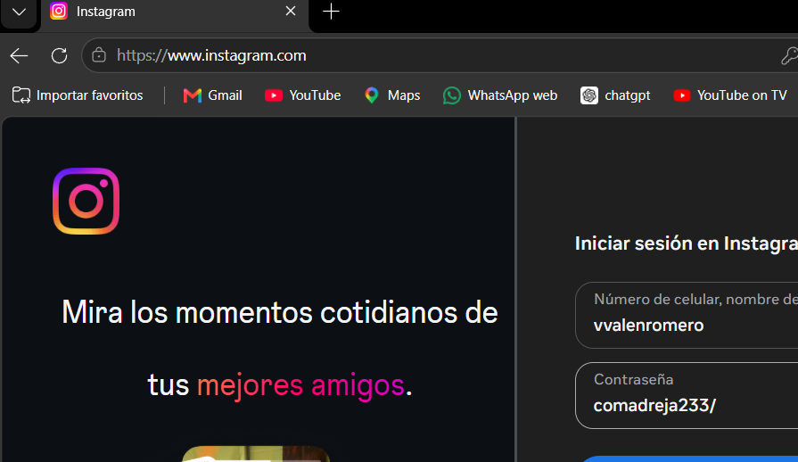

# Evidencias — TP4 · Sesiones de pago y webhook Stripe

Corrida real contra la API de **Stripe en modo test**, con el microservicio
levantado en `http://localhost:3003`.

**Fecha:** 17 de octubre de 2026
**Clave usada:** `rk_test_...` (clave restringida de test, no de producción)

---

## Entrega 1 — Creación de la Checkout Session

**Request** (el contrato exacto de la consigna):

```http
POST /payments/create-payment-session
Content-Type: application/json

{
  "orderId": "ord-1",
  "currency": "usd",
  "items": [ { "name": "Producto", "price": 20, "quantity": 1 } ]
}
```

**Response real de Stripe — `HTTP 201`:**

```json
{
  "id": "cs_test_a1kG6Vn09zuHy7lox5Ohj7PeKUDqAMxGeZi8kwrGx4wolWVBtSRysiv6no",
  "url": "https://checkout.stripe.com/c/pay/cs_test_a1kG6Vn09zuHy7lox5Ohj7PeKUDqAMxGeZi8kwrGx4wolWVBtSRysiv6no#fidnandh..."
}
```

La sesión existe del lado de Stripe y el cliente recibe la `url` para
redirigir al checkout. ✔ *Criterio de aceptación 1: request válido crea sesión y
devuelve `url`.*

### El `orderId` queda en la metadata del PaymentIntent

En `payments.service.ts` la sesión se crea con:

```ts
payment_intent_data: { metadata: { orderId: dto.orderId } },
```

Por eso después el webhook puede recuperarlo desde `charge.metadata.orderId`.
✔ *Criterio de aceptación 1.*

---

## Entrega 1 — Validación de requests inválidos

| Caso | Resultado |
| --- | --- |
| Sin `items` | `HTTP 400` |
| `price` negativo (`-5`) | `HTTP 400` |
| Campo de más en el body (`"hackeado": true`) | `HTTP 400` |

El `ValidationPipe` global corre con `whitelist` y `forbidNonWhitelisted`, así
que un campo que no está en el DTO no se ignora: se rechaza. ✔ *Criterio de
aceptación 1: request inválido responde 400.*

---

## Rutas de apoyo

```http
GET /payments/success  →  {"ok":true,"message":"Payment successful"}
GET /payments/cancel   →  {"ok":false,"message":"Payment cancelled"}
```

Con el texto exacto que pide la consigna.

---

## Entrega 2 — Webhook

### Firma inválida o ausente: no se procesa

| Caso | Resultado |
| --- | --- |
| Sin header `stripe-signature` | `HTTP 400` — `Falta el header stripe-signature` |
| Header inventado (`t=1,v1=deadbeef`) | `HTTP 400` — `Firma invalida: No signatures found matching the expected signature for payload` |
| Firma válida, evento `charge.succeeded` | `HTTP 200` — `{"received":true}` |

✔ *Criterio de aceptación 4.1: un POST sin firma válida no se trata como pago.*

### El `orderId` llega y se registra

Captura de la consola del microservicio durante la corrida real:



En la captura se leen las tres partes:

1. **Arranque y rutas mapeadas**: `AppController {/}`, `PaymentsController
   {/payments}` y las cuatro rutas (`create-payment-session` POST, `success`
   GET, `cancel` GET, `webhook` POST), con `payments-ms escuchando en
   http://localhost:3003`.
2. **Firma inválida descartada**:
   `WARN [PaymentsController] Firma invalida, evento descartado: No signatures found matching...`
   → Stripe reintentaría, pero el evento **no se procesa**.
3. **Pago confirmado**:
   `LOG [PaymentsController] PAGO CONFIRMADO - orderId=ord-1`
   → el `orderId` que mandó el cliente en la Entrega 1 volvió en el webhook.

✔ *Criterio de aceptación 4.1: tras el evento, el MS muestra el `orderId` de la
Entrega 1.* ✔ *Respuesta `200` a Stripe en el camino feliz.*

---

## Cómo reproducir la evidencia

```bash
# 1. Levantar el microservicio (necesita .env con las claves de test)
npm start

# 2. Entrega 1: crear la sesión
curl -X POST http://localhost:3003/payments/create-payment-session \
  -H 'Content-Type: application/json' \
  -d '{"orderId":"ord-1","currency":"usd","items":[{"name":"Producto","price":20,"quantity":1}]}'

# 3. Entrega 2: mandar un charge.succeeded firmado, como lo haría Stripe
node evidencias/prueba-webhook.mjs
```

`evidencias/prueba-webhook.mjs` no tiene secretos escritos: lee
`STRIPE_ENDPOINT_SECRET` del `.env` y firma el evento con
`stripe.webhooks.generateTestHeaderString`, que produce una firma válida igual
que la de Stripe.

En producción, la confirmación real se hace con Stripe CLI:

```bash
stripe listen --forward-to localhost:3003/payments/webhook
```

---

## Checks del repositorio

```bash
npm test              # 1 test (e2e)
npx tsc --noEmit      # sin errores
```

> `.env` no está versionado; el repo incluye `.env.template`.
